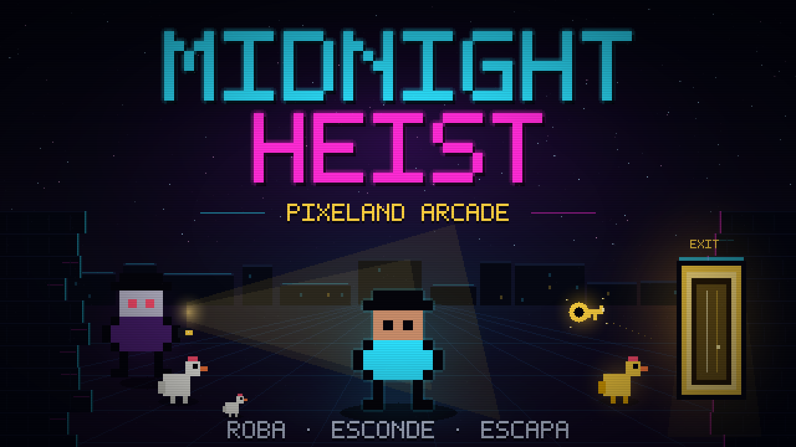

# Midnight Heist: Pixeland Arcade



Juego arcade de sigilo y laberintos en pixel art, hecho con **un solo archivo HTML** y **cero assets**: todo (escenarios, personajes, luces y sonido) se genera con código en el navegador.

## Jugar

Abre `index.html` en un navegador moderno, o sirve la carpeta:

```bash
python3 -m http.server 8080
```

Luego visita <http://localhost:8080>.

## Controles

- **WASD / Flechas**: mover
- **← / →**: elegir dificultad en el menú
- **E**: esconderse / salir / abrir cajas sorpresa
- **P / ESC**: pausar / reanudar
- **R**: reiniciar partida y volver al menú (solo en pausa)
- **Enter / clic / toque**: empezar / continuar (en el menú, tocar NORMAL o DIFICIL elige y empieza)
- **Botón ||**: pausa en pantalla durante la partida

## Mecánicas principales

- **Pantalla completa responsiva:** el canvas ocupa el 100% del viewport; el laberinto se escala de forma uniforme y centrada, sin distorsión, con barras del mismo fondo en pantallas de otra proporción.
- **Dificultades Normal y Difícil:** se eligen en el menú. Normal ofrece 300 s iniciales que bajan con el nivel, 3 guardias iniciales (máximo 6), 3 gallinas blancas, 70% de cajas buenas y guardias que ganan velocidad y visión con el nivel. Difícil fija 150 s, 5 guardias, 4 gallinas blancas y 30% de cajas buenas, sin escalado adicional.
- **Visibilidad limitada:** el laberinto está a oscuras. El jugador y los guardias (hasta 5 en Difícil y hasta 6 en Normal) usan linternas con conos de luz dinámicos que las paredes bloquean. Entrar en el haz de un guardia inicia una persecución.
- **Audio procedural 8-bit:** música de fondo groovy que cambia de tempo, timbre y tonalidad en cada nivel; persecución acelerada cuando un guardia te ilumina y arpegio de victoria. Todo se sintetiza con osciladores square/triangle/sawtooth de la Web Audio API, sin archivos de sonido.
- **Invulnerabilidad inmediata al esconderse:** si logras interactuar con un escondite (caja, barril, cuadro, etc.), te vuelves **100% indetectable e invulnerable al instante**. Aunque un guardia te esté iluminando directamente y vea cómo te escondes, cancela la persecución de inmediato, muestra un símbolo **?**, pierde el interés y vuelve a su ruta de patrulla normal. El jugador siempre se salva si logra accionar un escondite a tiempo.
- **Persecución sin bloqueos y única zona segura:** pegarse a una pared, mirar hacia los lados o quedarse completamente quieto **no congela a la IA**. El guardia rodea obstáculos, se acerca al jugador y ejecuta la captura al tocar su hitbox, incluso si está arrinconado contra una pared. La **única** forma de detener una persecución es accionar un escondite.
- **Patrullaje independiente y constante:** cada guardia elige y recorre su propia ruta por el laberinto, con objetivos y tiempos independientes. Los guardias siguen patrullando aunque el jugador esté completamente quieto.
- **Cajas sorpresa (probabilidad según dificultad):** en Normal cada caja tiene un **70% de probabilidad de dar un bonificador** (velocidad x2, invisibilidad temporal o guardias paralizados) y un **30% de dar una penalización**; en Difícil la proporción se invierte (30% bonificador / 70% penalización). Las penalizaciones son controles invertidos, linterna apagada 10 segundos o alerta de ruido que atrae a los guardias.
- **Mapa rectangular 31×17:** laberinto panorámico que aprovecha la pantalla 16:9 y reduce las barras vacías laterales.
- **Salida aleatoria y llave segura:** la puerta aparece en una celda de suelo aleatoria al iniciar el nivel. La llave surge al reunir las gallinas blancas requeridas (3 en Normal, 4 en Difícil) y solo puede aparecer en celdas cuya distancia Manhattan a la puerta sea mayor a 8 casillas.
- **Menú pixel art animado en Canvas:** el título, el selector NORMAL/DIFICIL y el sprite del protagonista se dibujan con matrices de bits y primitivas de Canvas. El fondo usa un mapa ficticio exclusivo del menú, con el jugador caminando, escondiéndose y siendo perseguido automáticamente, sin revelar el layout ni los objetos del nivel real.
- **Pausa y reinicio:** P, ESC o el botón `||` pausan la partida. Solo en pausa aparece el botón de reinicio; R o ese botón vuelven al menú principal y reinician todo el progreso.
- **Gallinas y llave:** roba las **gallinas blancas requeridas** (3 en Normal, 4 en Difícil) para que aparezca la llave; recógela y llega a la puerta. Las **6 gallinas de oro** dan puntos extra y, si reúnes las 6, la llave y la salida brillan a través de la oscuridad.
- **Alerta Máxima:** al aparecer la llave, los guardias amplían su cono de luz y aceleran su patrullaje. La persecución y el escondite siguen funcionando igual, por lo que la huida sigue siendo posible.
- **Límite de tiempo:** Normal empieza en **300 segundos** y baja 4 s por nivel (264 s en el nivel 10); Difícil fija **150 segundos**. Si se agotan, pierdes una vida y se reinicia el nivel.
- **Cinco vidas y Game Over:** el HUD inferior dibuja 5 corazones con Canvas junto a PTS; cada captura o tiempo agotado consume una vida. Al quedarte sin vidas aparece GAME OVER y el juego vuelve al menú reiniciando nivel, puntuación y progreso.

## Objetivo

- Roba las gallinas blancas requeridas, consigue la llave y escapa por la puerta antes de que termine el tiempo o se acaben tus 5 vidas.
- Reúne las 6 gallinas de oro para activar la guía luminosa hacia la salida.

## Los 10 niveles

1. Laberinto de Neón
2. Reino Fúngico
3. Ruinas de Insectos
4. Zona de Guerra
5. Las Profundidades
6. Turno de Noche
7. Colina Verde
8. Cuadrilátero Explosivo
9. Mazmorra del Héroe
10. Glitchland (mezcla aleatoria)

## Reglas del reto

- `index.html` pesa **menos de 32,000 bytes**.
- Sin librerías, frameworks ni motores.
- Cero assets externos: gráficos y sonido por código.
- Repositorio nuevo e idea original (homenajes temáticos, sin copiar assets ni personajes).
- **Cualquiera puede participar**, esté o no en el hackatón.

## Contribuir

Abre un issue o envía un pull request. No necesitas estar en el hackatón: mejoras de balance, nuevos temas, accesibilidad, mobile, etc. son bienvenidas. Mantén el juego en un solo archivo y por debajo de 32 KB.

## Licencia

MIT. Ver `LICENSE`.
